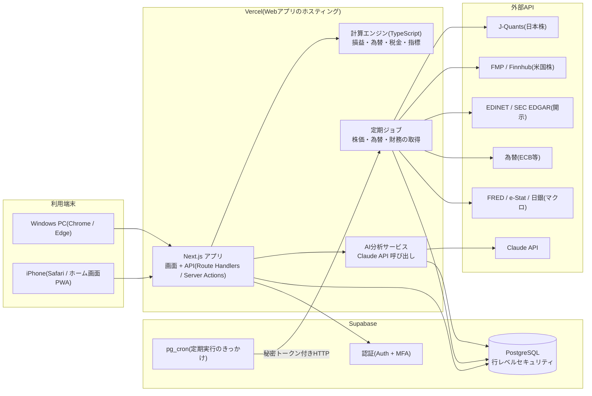

# 1. システム全体の設計書

**この章で決めること:** どんな部品でシステムを作るか、部品同士がどうつながるか、なぜその技術を選ぶか。

---

## 1.1 全体像



### 処理の流れ(1日の例)

| 時刻(日本時間) | 処理 | 担当 |
|---|---|---|
| 06:30 | 米国市場の終値・為替を取得 → 評価額を再計算 → 日次スナップショット保存 | 定期ジョブ + 計算エンジン |
| 07:00 | 朝のレポート生成(保有銘柄の状況・ニュース・マクロ) | AI分析サービス |
| 16:30 | 日本市場の終値を取得 → 再計算 → スナップショット更新 | 定期ジョブ + 計算エンジン |
| 週1回 | 財務データ・決算予定・マクロ指標の更新 | 定期ジョブ |
| 決算発表後 | 該当銘柄のAI分析を再実行 | AI分析サービス |
| 任意 | 画面から「この銘柄を分析」ボタンで即時分析 | AI分析サービス |

※ 日本株は J-Quants の仕様上「日足」が基本です。リアルタイム株価は第1段階では対象外とし、
  「終値ベース(場中は前日終値 + 任意で遅延株価)」で設計します(05章参照)。

---

## 1.2 技術選定

| 領域 | 採用 | 理由(初心者向け説明) |
|---|---|---|
| 言語 | **TypeScript** | 型(データの形)をコードに書けるので、金額と数量の取り違えなどをエディタが事前に教えてくれる |
| フレームワーク | **Next.js(App Router)** | 画面とサーバー処理を1つのプロジェクトで書ける。情報量が多く困ったとき調べやすい |
| UI部品 | **Tailwind CSS + shadcn/ui** | 見た目を細かく調整でき、ダークモードも標準対応。部品のコードが手元に入るので改造しやすい |
| グラフ | **Recharts**(資産推移・円グラフ)、**TradingView Lightweight Charts**(ローソク足) | どちらも無料。株価チャートは金融向け専用ライブラリの方が見やすい |
| データベース | **Supabase(PostgreSQL)** | 本格的なDB・ログイン機能・定期実行が1つのサービスで揃う。無料枠あり |
| DB操作 | **supabase-js + 自動生成の型** | DBのテーブル定義から TypeScript の型を自動生成し、ズレを防ぐ |
| 入力チェック | **Zod** | 画面入力・外部APIの返り値・AIの出力を「決めた形か」検証する |
| 金額計算 | **decimal.js** | JavaScriptの普通の数値は `0.1 + 0.2 = 0.30000000000000004` になる。金額は必ず10進数ライブラリで計算 |
| テスト | **Vitest** | 計算ロジック(損益・税金・為替)は必ずテストを書いて正しさを保証する |
| AI | **Claude API(公式SDK `@anthropic-ai/sdk`)** | 構造化出力(JSONの形を強制)が使えるので、判断・スコアを確実に取り出せる |
| ホスティング | **Vercel** | GitHub に push するだけで自動公開。Next.js 開発元なので相性が最良 |
| 定期実行 | **Supabase pg_cron → Next.js の API を呼ぶ**(予備: GitHub Actions) | Vercel無料プランのCronは回数制限があるため、Supabase側から起動する |
| Python | **第1段階では使わない** | 必要になったら(バックテスト・高度な統計)Phase 8 で別サービスとして追加 |

### Python を最初は使わない理由
言語が2つになると、環境構築・デプロイ・エラー対応がすべて2倍になります。
テクニカル指標(移動平均・RSI・MACD・ボリンジャーバンド・ATR)や財務指標の計算は
TypeScript で十分正確に書けるため、まずは1言語で完成させます。

---

## 1.3 プログラム構成(フォルダ設計)

```
ai-investment-assistant/
├─ src/
│  ├─ app/                    # 画面(ページ)と API
│  │  ├─ (dashboard)/         # ログイン後の画面群
│  │  ├─ login/
│  │  └─ api/
│  │     ├─ jobs/             # 定期ジョブの入口(秘密トークン必須)
│  │     └─ ai/               # AI分析の実行
│  ├─ components/             # 画面部品(カード・グラフ・表)
│  ├─ domain/                 # ★ 計算エンジン(画面やDBに依存しない純粋な計算)
│  │  ├─ money.ts             #   金額・通貨型
│  │  ├─ portfolio.ts         #   保有・評価額・損益
│  │  ├─ costBasis.ts         #   取得単価(移動平均法)
│  │  ├─ fx.ts                #   円換算・為替差損益の分解
│  │  ├─ tax.ts               #   税金の概算
│  │  ├─ metrics.ts           #   PER・PBR・ROE・成長率
│  │  ├─ technicals.ts        #   移動平均・RSI・MACD・ATR
│  │  └─ valuation.ts         #   目標株価・シナリオ計算
│  ├─ providers/              # 外部APIごとの取得処理(差し替え可能)
│  │  ├─ jquants.ts
│  │  ├─ fmp.ts
│  │  ├─ fx.ts
│  │  └─ ...
│  ├─ ai/                     # Claude 呼び出し・プロンプト・出力検証
│  ├─ db/                     # DBアクセス
│  └─ lib/                    # 共通処理(日付・ログ)
├─ supabase/
│  └─ migrations/             # テーブル定義(SQL)の履歴
└─ tests/
```

**ポイント:** `domain/`(計算)は、画面・DB・外部APIのどれにも依存させません。
こうすると計算だけを単体テストでき、「数字が正しい」ことを保証しやすくなります。
また `providers/` を分けておくことで、APIサービスを乗り換えるときも1ファイルの差し替えで済みます。

---

## 1.4 設計原則(すべての実装で守るルール)

### (1) 数値の正確性
- 金額はすべて `decimal.js`(DBは `numeric` 型)で扱い、浮動小数点数を使わない
- 金額は必ず「値 + 通貨」のセットで持つ(`{ amount: "123.45", currency: "USD" }`)。通貨の違う金額は足し算できないよう型で防ぐ
- 端数処理(切り捨て・四捨五入)のルールを1か所に定義する
- 計算ロジックには必ずテストを書く(例: 証券会社の取引報告書と1円単位で一致するか)

### (2) データの出典と鮮度
- 外部から取得したすべてのデータに `source`(出典)と `fetched_at`(取得日時)と `as_of`(データの基準日)を保存
- 画面の数値の横に「J-Quants / 2026-11-12 終値」のように表示
- 一定期間更新されていないデータは「古いデータ」バッジを表示
- 取得失敗時は前回値を使わず「取得失敗」と表示(前回値を見せる場合は日付を明示)

### (3) 「推測で埋めない」
- 欠損値は `null` として保存し、画面では「—(データなし)」と表示
- AIに渡すデータにも「この項目は取得できていない」と明示し、AIが値を作り出さないよう指示 + 出力検証(09章)

### (4) 通貨の区別
- 外貨建て資産は「外貨での損益」と「円換算での損益」を両方表示
- 円換算損益は「株価要因」と「為替要因」に分解(04章 4.6)

### (5) 税金・手数料・為替の区別
- 取引ごとに 手数料 / 消費税 / 源泉徴収税 / 為替スプレッド を別項目で記録
- 損益表示は「税引前」「税引後(概算)」を切り替え可能
- 税額はあくまで概算であり、確定申告の根拠は証券会社の年間取引報告書であることを画面に明記

### (6) AIの役割分担
| プログラムが行う | Claude が行う |
|---|---|
| 評価額・損益・配分の計算 | 数値の意味の解釈・説明 |
| PER/PBR/ROE/成長率の計算 | 成長性・競争優位性・業界の将来性の評価 |
| テクニカル指標の計算 | 指標の組み合わせからの局面判断 |
| 価格候補(バリュエーション・支持線・ATR)の算出 | 候補の中からの選択と、その理由の説明 |
| シナリオ別株価の計算(EPS×PER) | シナリオの前提の妥当性評価 |
| AI出力の形式チェック・数値の照合 | 投資判断(6段階)・リスク・確信度の提示 |

---

## 1.5 コスト見積もり(月額・概算)

| 項目 | 最小構成 | 推奨構成 |
|---|---|---|
| Vercel | 0円(Hobby) | 0円 |
| Supabase | 0円(Free) | 0円 → 必要なら Pro $25 |
| J-Quants(日本株) | 0円(Free: 12週遅延) | 1,650円(Light)〜3,300円(Standard) |
| 米国株データ(FMP等) | 0円(無料枠) | 約 $22(FMP Starter) |
| 為替・マクロ(ECB/FRED/e-Stat) | 0円 | 0円 |
| Claude API | 約 $5〜15 | 約 $10〜30(銘柄数・頻度次第) |
| **合計** | **約1,000〜2,500円** | **約6,000〜10,000円** |

※ 料金は 2026年11月時点の調査値。契約前に公式サイトで再確認します(05章)。
※ Supabase Free は「1週間アクセスがないと一時停止」の仕様がありますが、毎日の定期ジョブが動くので通常は止まりません。
