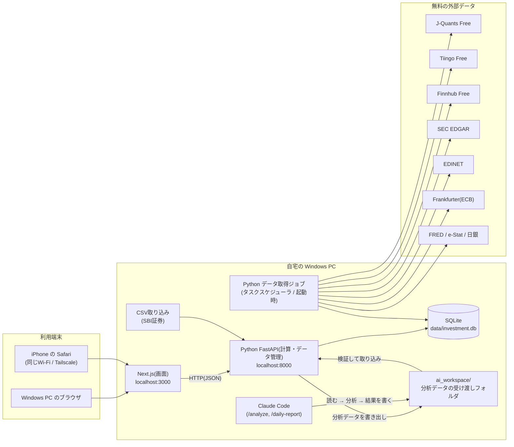

# 1. システム全体の設計(ローカルPC・無料構成)

**この章で決めること:** どんな部品で作り、どうつながり、なぜその技術を選ぶか。

---

## 1.1 全体像



### 役割分担

| 部品 | 役割 | 計算をするか |
|---|---|---|
| **Next.js(TypeScript)** | 画面表示・入力フォーム・グラフ | **しない**(表示と入力だけ) |
| **Python(FastAPI)** | DB読み書き・資産計算・指標計算・CSV取り込み・AI結果の検証 | **する(唯一の計算場所)** |
| **Python ジョブ** | 外部APIからのデータ取得、日次スナップショット作成 | する |
| **SQLite** | すべてのデータを1つのファイルに保存 | — |
| **Claude Code** | 分析・解釈・レポート作成(手動実行) | しない(プログラムが計算した数値を読むだけ) |

> **計算を Python だけに集約する理由:** 同じ計算を TypeScript と Python の両方に書くと、
> 結果がずれる原因になります。「数字はすべて Python が出す」と決めておくと、テストも1か所で済みます。

---

## 1.2 技術選定

| 領域 | 採用 | 理由 |
|---|---|---|
| 画面 | **Next.js + TypeScript** | ご指定。PC・iPhone 両対応の画面を作りやすい |
| UI部品 | Tailwind CSS + shadcn/ui | ダークモード対応、無料 |
| グラフ | Recharts(資産推移・配分)、TradingView Lightweight Charts(ローソク足) | 無料(後者はApache 2.0、帰属表示が必要) |
| 計算・API | **Python 3.12 + FastAPI** | 金額計算に正確な `Decimal` 型が標準で使える。データ分析の部品(pandas)が豊富 |
| データ検証 | Pydantic(Python)、Zod(画面の入力チェック) | 入力・外部API・AI出力の形を検証 |
| DB | **SQLite** | 無料・インストール不要・ファイル1つ。個人用には十分な性能 |
| DB操作 | SQLAlchemy 2 + Alembic(テーブル変更の履歴管理) | 定番で情報が多い |
| データ処理 | pandas(テクニカル指標の計算) | |
| テスト | pytest(Python)、Vitest(画面の一部) | 計算ロジックは必ずテスト |
| 定期実行 | **Windows タスクスケジューラ** + アプリ起動時の補完処理 | 無料・Windows標準 |
| 秘密情報 | `.env`(Git管理外)+ Windows資格情報マネージャー(Python `keyring`) | 無料 |
| AI | **Claude Code**(カスタムコマンド) | 従量課金なし。将来 Claude API に差し替え可能な設計 |
| iPhone接続 | 同じWi-Fi / Tailscale 無料プラン | 0円 |

### 金額の正確性(SQLite 特有の注意)
SQLite には正確な10進数の型がありません。そのため:
- 金額・数量・為替レートは **文字列(TEXT)として保存**(例 `"1234.56"`)し、Python で `Decimal` に変換して計算
- 浮動小数点数(`float`)は金額計算に一切使わない
- 画面(TypeScript)は Python から受け取った文字列を表示するだけ

---

## 1.3 フォルダ構成

```
ai-investment-assistant/
├─ web/                        # Next.js(画面)
│  └─ src/app/ ...
├─ backend/                    # Python
│  ├─ app/
│  │  ├─ api/                  # FastAPI の入口(画面から呼ばれる)
│  │  ├─ domain/               # ★ 計算エンジン(純粋な計算・テスト対象)
│  │  │  ├─ money.py           #   金額と通貨
│  │  │  ├─ cost_basis.py      #   移動平均法
│  │  │  ├─ portfolio.py       #   評価額・損益・配分
│  │  │  ├─ fx.py              #   為替損益の分解
│  │  │  ├─ tax.py             #   税金概算
│  │  │  ├─ metrics.py         #   PER・PBR・ROE・成長率
│  │  │  ├─ technicals.py      #   移動平均・RSI・MACD・ATR
│  │  │  ├─ valuation.py       #   価格候補・シナリオ
│  │  │  ├─ rules.py           #   ルールベース判定
│  │  │  ├─ risk.py            #   集中度・下落シミュレーション
│  │  │  └─ goals.py           #   目標シミュレーション
│  │  ├─ providers/            # 外部データ取得(1サービス1ファイル)
│  │  ├─ importers/            # CSV取り込み(SBI証券)
│  │  ├─ ai/                   # 分析データ書き出し・AI結果の検証・取り込み
│  │  ├─ jobs/                 # 定期ジョブ
│  │  └─ db/                   # テーブル定義・マイグレーション
│  └─ tests/
├─ .claude/commands/           # Claude Code 用コマンド(/analyze など)
├─ ai_workspace/               # AIとの受け渡し(Git管理外)
├─ data/                       # SQLite・取り込んだCSV(Git管理外)
├─ scripts/start.bat           # ダブルクリックで画面とPythonを同時起動
└─ docs/
```

---

## 1.4 処理の流れ

### 普段の使い方
| タイミング | 操作 | 自動/手動 |
|---|---|---|
| PC起動時 | タスクスケジューラが Python を起動 → 前回以降の米国株価・為替・マクロを取得 → 不足日の資産スナップショットを補完 | 自動 |
| 毎朝 7:00(PC起動中) | 米国株終値・為替を取得 → 評価額更新 | 自動 |
| 日本株の評価を更新したいとき | SBI証券からポートフォリオCSVをダウンロード → 画面にドラッグ&ドロップ | 手動(1分程度) |
| 取引したとき | 取引履歴CSVを取り込み、または手入力 | 手動 |
| AI分析が欲しいとき | Claude Code で `/analyze 7203` | 手動 |
| 週末 | Claude Code で `/weekly-report` | 手動 |
| 週1回 | 財務・決算予定・マクロの更新 | 自動 |

### 起動
`scripts/start.bat` をダブルクリック → Python(8000番)と Next.js(3000番)が起動 → ブラウザが開く。
PC起動時に自動起動する設定も可能です。

---

## 1.5 無料枠を守る仕組み(開発ルール3の実装)

| 仕組み | 内容 |
|---|---|
| 呼び出し回数の記録 | `api_usage` テーブルに、サービスごと・日ごとの呼び出し回数を記録 |
| 安全上限 | 無料枠の **80%** を上限に設定(例: Tiingo 1日1,000回 → 800回)。到達したらその日は停止し「上限到達のため未取得」と表示 |
| 間隔制御 | 1分・1時間あたりの上限も守るよう、呼び出し間隔を自動調整 |
| 必要最小限の取得 | 保有+ウォッチ銘柄のみ、取得済みデータは再取得しない |
| 有料エンドポイントは呼ばない | 各 provider に「無料で使えるエンドポイント一覧」を定義し、それ以外は呼べない作り |
| 有料APIの無効化 | Claude API など従量課金のものは設定で明示的に有効化しない限り使えない(既定: 無効) |
