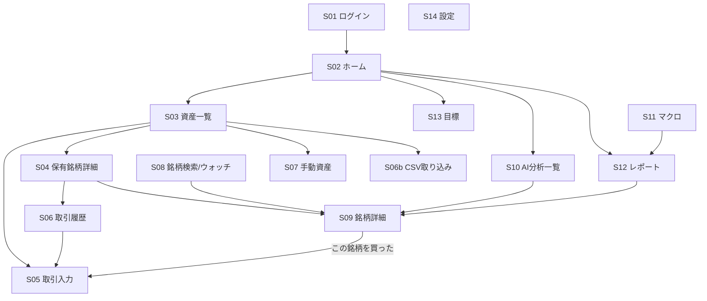

# 3. 画面構成と画面遷移

**この章で決めること:** どんな画面があり、どう移動するか。スマホとPCでの見せ方。

> v0.2: ローカルPC構成に合わせ、ログインをパスコード方式に変更、CSV取り込み画面を追加、株価色を米国式に確定。
> 画面は PC(`http://localhost:3000`)と iPhone(同じWi-Fi / Tailscale 経由)で同じものを表示します。

---

## 3.1 画面一覧

| # | 画面 | URL | 主な内容 |
|---|---|---|---|
| S01 | ロック解除 | `/login` | パスコード入力(iPhone等からのアクセス時) |
| S02 | ホーム(ダッシュボード) | `/` | 総資産・前日比・資産推移グラフ・資産配分・目標進捗・本日のAIサマリー・要注目銘柄 |
| S03 | 資産一覧 | `/assets` | 口座別/資産クラス別の保有一覧、評価額・含み損益 |
| S04 | 保有銘柄詳細 | `/assets/holdings/[id]` | 取得単価・数量・取引履歴・損益の内訳(株価要因/為替要因)・税金概算 |
| S05 | 取引入力 | `/transactions/new` | 買付・売却・配当・入出金・両替の入力フォーム |
| S06 | 取引履歴 | `/transactions` | 絞り込み・修正・削除 |
| S06b | CSV取り込み | `/import` | SBI証券CSVをドラッグ&ドロップ → プレビュー(新規/重複/エラー)→ 確定。保有数量の照合結果 |
| S07 | 手動資産 | `/assets/manual` | 不動産・未上場株などの評価額入力と履歴 |
| S08 | 銘柄検索 / ウォッチリスト | `/stocks` | 検索・ウォッチリスト・AI判断の一覧 |
| S09 | 銘柄詳細 | `/stocks/[symbol]` | タブ: 概要 / チャート / 財務 / ニュース / **AI分析** / 売買タイミング |
| S10 | 分析一覧 | `/analysis` | ルールベース判定とAI判断の一覧、分析履歴、「Claude Codeで分析する手順」の案内 |
| S11 | マクロ経済 | `/macro` | 金利・為替・インフレ・景気・金融政策・テーマ |
| S12 | レポート | `/reports`, `/reports/[id]` | 日次/週次/月次レポートの一覧と本文 |
| S13 | 目標・シミュレーション | `/goals` | 目標額・進捗・将来予測 |
| S14 | 設定 | `/settings` | 投資方針・口座・データソースの状態・**無料枠の使用量**・バックアップ・パスコード |

---

## 3.2 画面遷移図



### ナビゲーション
- **スマホ(幅 < 768px):** 画面下部のタブバー
  `ホーム` / `資産` / `銘柄` / `レポート` / `その他(マクロ・目標・設定)`
  右下に「+」ボタン(取引入力)を常時表示
- **PC(幅 ≥ 1024px):** 左サイドバーに全メニュー、メイン領域は2〜3カラム

---

## 3.3 主要画面のレイアウト案

### S02 ホーム(スマホ)
```
┌───────────────────────────┐
│ 総資産                  ⚙ │
│ ¥ 32,450,120              │
│ 前日比 +¥182,300 (+0.56%) │
│ 米国株 11-13 06:35 / 日本株 │
│ SBI CSV 11-12 15:40 取込   │
├───────────────────────────┤
│ [資産推移グラフ] 1M 3M 1Y ALL│
├───────────────────────────┤
│ 目標 5,000万円 / 2035年    │
│ ███████░░░░ 64.9%          │
│ 必要年率 4.8%  現状ペース ◎ │
├───────────────────────────┤
│ 資産配分(ドーナツ)        │
│ 米国株42% 日本株28% 現金…  │
├───────────────────────────┤
│ 本日のAIサマリー           │
│ ・金利上昇で…(出典)       │
│ ・決算: 〇〇 11/14         │
├───────────────────────────┤
│ 要注目の銘柄               │
│ 〇〇  一部利益確定  確信度中 │
│ △△  買い           確信度高 │
└───────────────────────────┘
 [ホーム][資産][銘柄][レポート][…]
```

### S09 銘柄詳細 > AI分析タブ
```
┌───────────────────────────────────┐
│ 7203 トヨタ自動車   ¥3,012 (+1.2%) │
│ (表示例。数値は架空)              │
│ SBI証券CSV 2026-11-12 15:40 取込   │
├───────────────────────────────────┤
│  判断:【 保有 】                   │
│  総合スコア 68/100   確信度: 中     │
│  分析日 2026-11-13 / データ基準日 11-12│
├───────────────────────────────────┤
│ 観点別スコア(レーダーチャート)     │
│ 成長性 62 財務 81 競争優位 75 …     │
├───────────────────────────────────┤
│ 判断理由                            │
│ 1. …                               │
│ リスク                              │
│ ・…                                │
├───────────────────────────────────┤
│ 価格水準(根拠を展開表示)           │
│ 目標株価   ¥3,450 ▼根拠            │
│  └ 予想EPS 230円 × 過去5年PER中央値15倍│
│ 買い増し検討 ¥2,780 ▼根拠          │
│ 損切り検討  ¥2,520 ▼根拠           │
├───────────────────────────────────┤
│ シナリオ  弱気 ¥2,400 / 基本 ¥3,450 / 強気 ¥4,100│
├───────────────────────────────────┤
│ 使用データ(出典・取得日時の一覧)   │
│ ⚠ 不明: 直近12週の一部株価(CSV未取込日)│
│ ルールベース判定: 保有(参考)        │
└───────────────────────────────────┘
```

---

## 3.4 デザイン方針(金融ターミナル風)

| 項目 | 方針 |
|---|---|
| 配色(ダーク既定) | 背景: ほぼ黒の紺 `#0B0F17`、カード: `#121826`、罫線: `#1F2937`、アクセント: ゴールド `#C9A227` |
| 上昇/下落の色 | **米国式(上昇=緑 / 下落=赤)**(ご回答により確定)。設定で日本式にも切替可 |
| 数字のフォント | 等幅数字(`tabular-nums`)で桁が揃うようにする。英数字は Inter / JetBrains Mono、日本語は Noto Sans JP |
| 判断バッジの色 | 強い買い(濃い強調)/ 買い / 保有(中立グレー)/ 一部利益確定(琥珀)/ 売却(強調)/ 様子見(青灰) ※上昇下落色と混同しない色を選ぶ |
| 情報密度 | PCは高密度(表中心)、スマホはカード中心で1画面1テーマ |
| 出典表示 | 数値の下に小さく灰色で「出典 / 日時」。タップで詳細 |
| アクセシビリティ | 色だけに頼らず「▲▼」「+/-」の記号も併記 |
| ライトモード | 設定で切替可能(明るい場所でのスマホ閲覧用) |
| 免責表示 | AI分析画面の下部に「AIによる参考情報です。最終判断はご自身で行ってください」を常時表示 |
