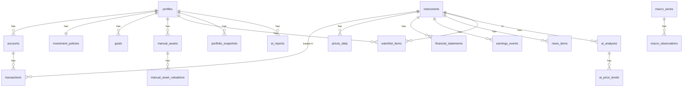

# 4. データベース設計

**この章で決めること:** どんなデータを、どんな表(テーブル)に、どんな形で保存するか。

## 4.0 設計の基本ルール

| ルール | 内容 |
|---|---|
| 金額の型 | `numeric(20,6)`(小数6桁まで正確に保存。浮動小数点 `float` は使わない) |
| 数量の型 | `numeric(20,8)`(米国株の端株・投資信託の口数に対応) |
| 通貨 | ISO 4217 の3文字(`JPY`, `USD`)を `char(3)` で保存 |
| 日時 | `timestamptz`(タイムゾーン付き)。日付だけのものは `date` |
| ID | `uuid` |
| 所有者 | すべての個人データ表に `user_id` を持たせ、行レベルセキュリティ(RLS)で本人以外は読めないようにする |
| 出典 | 外部データの表には `source`, `fetched_at`, `as_of` を必ず持たせる |
| 欠損 | 取得できない値は `NULL`。0 や推測値で埋めない |
| 正(マスター)データ | **取引履歴(transactions)を唯一の正**とし、保有数量・取得単価は取引から計算で導く(手で上書きしない) |

## 4.1 ER図(全体)



---

## 4.2 ユーザー・設定

### `profiles`(ユーザー設定)
| 列 | 型 | 説明 |
|---|---|---|
| id | uuid PK | Supabase Auth のユーザーIDと同じ |
| base_currency | char(3) | 基準通貨(`JPY`) |
| price_color_style | text | `jp`(上昇赤)/ `us`(上昇緑) |
| timezone | text | `Asia/Tokyo` |
| created_at / updated_at | timestamptz | |

### `investment_policies`(投資方針:AI分析に渡す)
| 列 | 型 | 説明 |
|---|---|---|
| user_id | uuid PK | |
| horizon_years | int | 投資期間 |
| risk_tolerance | text | `low` / `medium` / `high` |
| max_single_stock_pct | numeric | 1銘柄の上限比率(例 15%) |
| max_drawdown_tolerance_pct | numeric | 許容できる最大下落率 |
| target_allocation | jsonb | 目標資産配分(例 `{"us_equity":40,"jp_equity":30,...}`) |
| preferences | text | 自由記述(好きなテーマ、避けたい業種など) |
| updated_at | timestamptz | |

### `goals`(資産目標)
| 列 | 型 | 説明 |
|---|---|---|
| id | uuid PK | |
| user_id | uuid | |
| name | text | 例「老後資金」 |
| target_amount_jpy | numeric | 目標額 |
| target_date | date | 期限 |
| monthly_contribution_jpy | numeric | 予定積立額 |

---

## 4.3 口座・銘柄・取引

### `accounts`(口座)
| 列 | 型 | 説明 |
|---|---|---|
| id | uuid PK | |
| user_id | uuid | |
| institution | text | 証券会社・銀行名 |
| name | text | 表示名 |
| account_type | text | `tokutei_withholding`(特定・源泉あり)/ `tokutei`(特定・源泉なし)/ `ippan` / `nisa_growth` / `nisa_tsumitate` / `old_nisa` / `ideco` / `bank` / `other` |
| is_tax_exempt | boolean | 非課税口座か(NISA・iDeCo) |
| is_active | boolean | |

### `instruments`(銘柄マスタ:全ユーザー共通)
| 列 | 型 | 説明 |
|---|---|---|
| id | uuid PK | |
| symbol | text | `7203`、`AAPL` |
| market | text | `TSE`, `NASDAQ`, `NYSE`, `FUND`(投信) |
| asset_class | text | `jp_equity`, `us_equity`, `etf`, `mutual_fund`, `reit`, `bond` |
| currency | char(3) | 取引通貨 |
| name / name_ja | text | |
| sector / industry | text | 業種(出典の分類名をそのまま保存) |
| country | text | |
| source / fetched_at | | |
| UNIQUE | (symbol, market) | |

### `transactions`(取引:システムの正データ)
| 列 | 型 | 説明 |
|---|---|---|
| id | uuid PK | |
| user_id | uuid | |
| account_id | uuid FK | |
| instrument_id | uuid FK NULL | 入出金・両替では NULL |
| type | text | `buy` / `sell` / `dividend` / `distribution` / `deposit` / `withdrawal` / `fx_exchange` / `split` / `fee` / `tax` / `interest` / `transfer_in` / `transfer_out` |
| trade_date | date | 約定日 |
| settle_date | date NULL | 受渡日 |
| quantity | numeric(20,8) NULL | |
| price | numeric(20,6) NULL | 約定単価(取引通貨) |
| currency | char(3) | 取引通貨 |
| gross_amount | numeric | 約定金額(取引通貨) |
| fee | numeric | 手数料(取引通貨) |
| fee_tax | numeric | 手数料の消費税 |
| withholding_tax_foreign | numeric | 外国源泉税(米国の配当10%など) |
| withholding_tax_domestic | numeric | 国内源泉税(20.315%など) |
| fx_rate | numeric(20,8) NULL | 約定時の為替レート(JPY/外貨)。**証券会社の報告書の値を入力** |
| fx_rate_type | text NULL | `broker`(証券会社の約定レート)/ `ttm` / `tts` / `ttb` |
| net_amount_jpy | numeric NULL | 受渡金額(円)。証券会社の報告書と照合する用 |
| split_ratio | numeric NULL | 分割比率(例 1株→3株 は 3) |
| note | text | |
| import_batch_id | uuid NULL | CSV取り込みの単位(取り消し用) |
| created_at / updated_at | | |

### `cash_balances` はテーブルにしない
現金残高も取引(入金・出金・売買代金・配当・両替)から計算で求めます。
ただし銀行口座など取引を記録しない口座のために、**`cash_snapshots`(残高の手入力)**を用意します。

| 列 | 型 | 説明 |
|---|---|---|
| id, user_id, account_id | | |
| currency | char(3) | |
| amount | numeric | |
| as_of | date | |

---

## 4.4 手動評価資産(不動産・未上場株など)

### `manual_assets`
| 列 | 型 | 説明 |
|---|---|---|
| id, user_id | | |
| name | text | 例「〇〇区ワンルーム」 |
| category | text | `real_estate` / `private_equity` / `crypto` / `insurance` / `pension` / `other` |
| currency | char(3) | |
| acquisition_cost | numeric | 取得価額 |
| acquisition_date | date | |
| liability_amount | numeric NULL | 関連する借入残高(不動産ローンなど) |
| details | jsonb | 不動産の家賃・経費など(Phase 6で詳細化) |

### `manual_asset_valuations`(評価額の履歴)
| 列 | 型 | 説明 |
|---|---|---|
| id, manual_asset_id | | |
| valuation_date | date | |
| value | numeric | 評価額 |
| liability_amount | numeric NULL | その時点の借入残高 |
| method | text | `appraisal`(査定)/ `comparable`(近隣事例)/ `self_estimate`(自己評価)/ `latest_round`(直近増資価格) |
| note | text | 根拠メモ |

画面では「最終評価日から〇日経過」を表示し、古い評価には注意バッジを出します。

---

## 4.5 市場データ(全ユーザー共通)

### `prices_daily`(日足)
| 列 | 型 | 説明 |
|---|---|---|
| instrument_id | uuid | |
| date | date | |
| open / high / low / close | numeric | |
| adj_close | numeric NULL | 分割・配当調整後 |
| volume | numeric | |
| source / fetched_at | | |
| PK | (instrument_id, date, source) | |

### `quotes_latest`(最新値:場中の遅延株価を使う場合のみ)
instrument_id PK, price, change, change_pct, as_of, source, fetched_at

### `fx_rates_daily`
| 列 | 型 | 説明 |
|---|---|---|
| base / quote | char(3) | `USD` / `JPY` |
| date | date | |
| rate | numeric(20,8) | 1 USD = rate JPY |
| rate_type | text | `reference`(ECB参照レート等)/ `close` / `ttm` |
| source / fetched_at | | |

### `financial_statements`(決算データ)
| 列 | 型 | 説明 |
|---|---|---|
| instrument_id | uuid | |
| period_type | text | `FY`(通期)/ `Q`(四半期) |
| fiscal_year / fiscal_quarter | int | |
| period_end | date | |
| is_forecast | boolean | 会社予想か実績か |
| revenue / operating_income / net_income | numeric NULL | |
| eps / bps / dps | numeric NULL | 1株あたり利益・純資産・配当 |
| total_assets / equity / interest_bearing_debt | numeric NULL | |
| operating_cf / free_cf | numeric NULL | |
| shares_outstanding | numeric NULL | |
| currency | char(3) | |
| accounting_standard | text | `JGAAP` / `IFRS` / `USGAAP` |
| disclosed_at | timestamptz | 開示日時 |
| source / fetched_at | | |

### `computed_metrics`(プログラムで計算した指標)
| 列 | 型 | 説明 |
|---|---|---|
| instrument_id, as_of | | |
| per_trailing / per_forward / pbr / roe / dividend_yield | numeric NULL | |
| revenue_growth_yoy / op_income_growth_yoy / net_income_growth_yoy | numeric NULL | |
| equity_ratio / de_ratio | numeric NULL | |
| sma_25 / sma_75 / sma_200 / rsi_14 / macd / macd_signal / atr_14 / hv_60 | numeric NULL | テクニカル |
| per_5y_median / per_5y_p25 / per_5y_p75 | numeric NULL | 過去PERの分布(割安判定用) |
| inputs | jsonb | 計算に使った元データのID・基準日(再現性のため) |
| calc_version | text | 計算ロジックのバージョン |

※ 外部APIが返すPER等をそのまま使わず、**自前で計算**します(定義の違いによるズレを防ぐ)。
  外部APIの値は照合用として `vendor_metrics` に別保存しても構いません。

### `earnings_events`(決算予定)
instrument_id, event_date, fiscal_period, time_of_day(`before_open`/`after_close`/`unknown`), is_confirmed, source, fetched_at

### `news_items`
| 列 | 型 | 説明 |
|---|---|---|
| id | uuid | |
| instrument_id | uuid NULL | 市場全体ニュースは NULL |
| title / summary | text | |
| url | text | 出典URL(必須) |
| publisher | text | |
| published_at | timestamptz | |
| language | text | |
| source / fetched_at | | |

※ ニュース本文の全文保存は著作権・利用規約に配慮し行わず、見出し・要約・URLのみ保存。

### `macro_series` / `macro_observations`
- `macro_series`: id, code(例 `DGS10`), name_ja, unit, frequency, source
- `macro_observations`: series_id, date, value, fetched_at, PK(series_id, date)

---

## 4.6 計算結果・スナップショット

### `portfolio_snapshots`(日次の資産記録)
| 列 | 型 | 説明 |
|---|---|---|
| user_id, date | PK | |
| total_value_jpy | numeric | 総資産 |
| total_cost_jpy | numeric | 取得価額合計 |
| unrealized_pnl_jpy | numeric | 含み損益 |
| realized_pnl_ytd_jpy | numeric | 年初来の実現損益 |
| breakdown | jsonb | 資産クラス別・通貨別・口座区分別の金額 |
| fx_rates_used | jsonb | 使用した為替レートと出典 |
| prices_as_of | jsonb | 使用した株価の基準日 |
| calc_version | text | |

※ 資産推移グラフはこの表から描きます。過去分は取引履歴 + 過去株価から再計算(バックフィル)も可能にします。

### `position_snapshots`(銘柄ごとの日次記録:任意)
user_id, date, account_id, instrument_id, quantity, avg_cost, market_value, market_value_jpy, unrealized_pnl_jpy, fx_component_jpy, price_component_jpy

---

## 4.7 AI分析

### `ai_analyses`
| 列 | 型 | 説明 |
|---|---|---|
| id | uuid | |
| user_id | uuid | |
| instrument_id | uuid | |
| rating | text | `strong_buy` / `buy` / `hold` / `trim` / `sell` / `watch`(画面では 強い買い/買い/保有/一部利益確定/売却/様子見) |
| overall_score | int | 0〜100 |
| confidence | text | `low` / `medium` / `high` |
| scores | jsonb | 9観点のスコアと短評 |
| reasons | jsonb | 判断理由(箇条書き、各理由に参照データID) |
| risks | jsonb | リスク要因 |
| missing_data | jsonb | 取得できず判断に使えなかったデータ |
| input_snapshot | jsonb | AIに渡したデータ全体(再現・検証用) |
| data_as_of | date | 使用データの基準日 |
| model | text | 使ったClaudeのモデル名 |
| prompt_version | text | プロンプトのバージョン |
| validation_status | text | `passed` / `failed`(出力検証の結果) |
| token_usage / cost_usd | | API料金の記録 |
| created_at | | |

### `ai_price_levels`
| 列 | 型 | 説明 |
|---|---|---|
| analysis_id | uuid | |
| kind | text | `new_entry` / `add_on` / `target` / `take_profit` / `stop_loss` |
| price | numeric | |
| currency | char(3) | |
| method | text | `per_band` / `pbr_band` / `dividend_yield_band` / `sma_support` / `atr_stop` / `pct_from_cost` など |
| basis | jsonb | 計算式と入力値(例 `{"eps_forecast":230,"per":15,"source":"..."}`) |
| expected_return_pct | numeric | 現在値からの騰落率 |

### `ai_scenarios`
analysis_id, scenario(`bear`/`base`/`bull`), horizon_months, eps_assumption, per_assumption, price, probability_note, assumptions(text)

### `ai_reports`
id, user_id, type(`daily`/`weekly`/`monthly`/`macro`), period_start, period_end, content_md, sections(jsonb), sources(jsonb), model, prompt_version, cost_usd, created_at

---

## 4.8 運用

| テーブル | 用途 |
|---|---|
| `watchlist_items` | user_id, instrument_id, memo, added_at |
| `job_runs` | 定期ジョブの実行記録(開始・終了・成否・取得件数・エラー内容) |
| `api_usage` | 外部API・Claude API の呼び出し回数と費用(使いすぎ防止) |
| `audit_logs` | 取引・設定の変更履歴(誰が・いつ・何を・変更前後) |
| `import_batches` | CSV取り込みの単位(取り消し可能に) |

---

## 4.9 主要な計算ルール

### (1) 取得単価:移動平均法
日本の特定口座・一般口座の「総平均法に準ずる方法」に合わせます。
```
買付後の平均取得単価 = (既存の取得価額合計 + 今回の取得価額(手数料込み)) ÷ (既存数量 + 今回数量)
売却時の取得価額     = 平均取得単価 × 売却数量
実現損益(税引前)   = 売却代金(手数料控除後) − 売却時の取得価額
```
- 口座(特定/一般/NISA)ごとに別々に計算します(同じ銘柄でも口座が違えば平均しない)
- 株式分割は数量×比率、単価÷比率で調整(取得価額合計は不変)

### (2) 外貨建て株式の円換算
```
円建て取得価額 = Σ(約定金額 + 手数料)× 約定時の為替レート
円建て評価額   = 現在値 × 数量 × 現在の為替レート
```
- 約定時のレートは**証券会社の取引報告書の値**を入力(なければ TTM 等を使い、種類を記録)
- 外貨での平均取得単価と、円での平均取得単価を**両方**保持

### (3) 為替差損益の分解(外貨建て資産)
```
P0 = 外貨建て平均取得単価, P1 = 現在値, Q = 数量
R0 = 加重平均の取得時レート, R1 = 現在のレート

株価要因 = (P1 − P0) × Q × R0
為替要因 = P1 × Q × (R1 − R0)
合計     = 株価要因 + 為替要因 = 円建て含み損益
```

### (4) 税金の概算
| 対象 | 計算 |
|---|---|
| 特定口座・一般口座の譲渡益 | 20.315%(所得税15% + 復興特別所得税0.315% + 住民税5%) |
| NISA | 非課税(0%)。損失は他口座と通算不可である旨を表示 |
| 国内株の配当 | 20.315% |
| 米国株の配当 | 米国源泉10% → 残額に国内20.315%(外国税額控除は概算対象外・注記のみ) |
| 年内の損益通算 | 特定口座間の譲渡損益を合算して概算 |

税率は設定テーブルで管理し、税制改正時に変更できるようにします。

### (5) 資産目標の進捗
```
達成率         = 現在の総資産 ÷ 目標額
必要年率リターン = 「現在額 + 毎月の積立」が期限に目標額へ到達する年率(数値計算で求める)
必要積立額     = 想定年率を固定したときに必要な毎月の積立額
```
