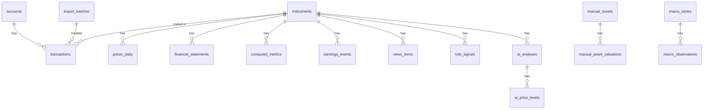

# 4. データベース設計(SQLite)

**この章で決めること:** どんなデータを、どの表に、どんな形で保存するか。

## 4.0 基本ルール

| ルール | 内容 |
|---|---|
| DBファイル | `data/investment.db`(1ファイル)。**Git には入れない** |
| 金額・数量・レート | **TEXT(10進数の文字列)**で保存し、Python の `Decimal` で計算。`REAL`(浮動小数点)は使わない |
| 通貨 | `JPY` / `USD` などの3文字 |
| 日付・日時 | ISO 8601 文字列(`2026-11-13`、`2026-11-13T06:35:00+09:00`) |
| ID | 整数の連番(`INTEGER PRIMARY KEY`) |
| 出典 | 外部・CSV・手入力すべてのデータに `source` と `fetched_at`(取得日時)、必要に応じ `as_of`(基準日) |
| 欠損 | 不明な値は `NULL`。0や推測値で埋めない |
| 正データ | **取引履歴(transactions)が唯一の正**。保有数量・取得単価は取引から計算 |
| 外部キー | `PRAGMA foreign_keys = ON` を常に有効化 |
| 変更履歴 | テーブル構造の変更は Alembic のマイグレーションで管理 |

利用者は1人のため、`user_id` 列は持ちません(将来複数人にする場合は追加)。

## 4.1 ER図



---

## 4.2 設定

### `settings`(キーと値)
| key の例 | 内容 |
|---|---|
| `base_currency` | `JPY` |
| `price_color_style` | `us` |
| `tax_rate_capital_gain` | `0.20315` |
| `tax_rate_us_dividend_withholding` | `0.10` |
| `ai_provider` | `claude_code`(既定)/ `claude_api`(無効)/ `none` |
| `quota_safety_ratio` | `0.8` |

### `investment_policy`(1行のみ)
horizon_years, risk_tolerance(`low`/`medium`/`high`), max_single_stock_pct, max_sector_pct, max_drawdown_tolerance_pct, target_allocation(JSON), themes(JSON), avoid(JSON), notes, updated_at

### `goals`
id, name, target_amount_jpy, target_date, monthly_contribution_jpy, assumed_return_pct

---

## 4.3 口座・銘柄・取引

### `accounts`
| 列 | 説明 |
|---|---|
| id | |
| institution | `SBI証券` など |
| name | 表示名 |
| account_type | `tokutei_withholding` / `tokutei` / `ippan` / `nisa_growth` / `nisa_tsumitate` / `old_nisa` / `ideco` / `bank` / `other` |
| is_tax_exempt | 0/1 |
| is_active | 0/1 |

### `instruments`
| 列 | 説明 |
|---|---|
| id | |
| symbol | `7203` / `AAPL` |
| market | `TSE` / `NASDAQ` / `NYSE` / `FUND` |
| asset_class | `jp_equity` / `us_equity` / `etf` / `mutual_fund` / `reit` / `bond` |
| currency | |
| name / name_ja | |
| sector / industry | 出典の分類名をそのまま |
| sec_cik | 米国株: SEC EDGAR の企業ID |
| edinet_code | 日本株: EDINET の企業コード |
| source / fetched_at | |
| UNIQUE(symbol, market) | |

### `transactions`
| 列 | 説明 |
|---|---|
| id | |
| account_id / instrument_id | 入出金・両替は instrument_id = NULL |
| type | `buy` / `sell` / `dividend` / `distribution` / `deposit` / `withdrawal` / `fx_exchange` / `split` / `fee` / `tax` / `interest` / `transfer_in` / `transfer_out` |
| trade_date / settle_date | 約定日 / 受渡日 |
| quantity / price | 数量 / 約定単価(取引通貨) |
| currency | 取引通貨 |
| gross_amount | 約定金額 |
| fee / fee_tax | 手数料 / 手数料の消費税 |
| withholding_tax_foreign / withholding_tax_domestic | 外国源泉税 / 国内源泉税 |
| fx_rate | 約定時レート(取引報告書の値) |
| fx_rate_type | `broker` / `ttm` / `tts` / `ttb` |
| net_amount_jpy | 受渡金額(円)。報告書との照合用 |
| split_ratio | 株式分割比率 |
| note | |
| source | `manual` / `sbi_csv` |
| import_batch_id | CSV取り込み単位(取消用) |
| dedup_key | 重複取り込み防止のキー(約定日+銘柄+数量+価格+口座のハッシュ) |
| deleted_at | 論理削除 |
| created_at / updated_at | |

### `import_batches`
id, file_name, file_sha256, csv_type(`sbi_jp_trades` / `sbi_us_trades` / `sbi_portfolio` 等), imported_at, rows_total, rows_imported, rows_skipped, status(`committed`/`reverted`)

### `holding_snapshots_broker`(SBI証券の保有CSVの内容)
id, import_batch_id, account_id, instrument_id, quantity, avg_cost_broker, current_price, market_value, currency, as_of
→ 自前計算と比較し、数量や平均取得単価の差異を「照合結果」として表示

### `cash_snapshots`(銀行などの残高の手入力)
id, account_id, currency, amount, as_of, source

---

## 4.4 手動資産

### `manual_assets`
id, name, category(`real_estate` / `private_equity` / `crypto` / `insurance` / `pension` / `other`), currency, acquisition_cost, acquisition_date, details(JSON), is_active

### `manual_asset_valuations`
id, manual_asset_id, valuation_date, value, liability_amount, method(`appraisal` / `comparable` / `self_estimate` / `latest_round`), note

**計上ルール(ご回答により確定):**
- 不動産は **純資産額 = 評価額 − ローン残高** を総資産に計上
- 詳細画面では評価額・ローン残高・純資産額を並べて表示
- 純資産額がマイナス(債務超過)の場合もそのまま計上し、警告表示
- 未上場株式・その他は評価額をそのまま計上(借入があれば同様に差し引き)
- 最終評価日からの経過日数を表示し、180日以上経過で「評価が古い」バッジ

---

## 4.5 市場データ

### `prices_daily`
| 列 | 説明 |
|---|---|
| instrument_id, date | |
| open / high / low / close / adj_close / volume | 取得できない項目は NULL(CSV由来は close のみの場合あり) |
| source | `jquants_free` / `tiingo` / `finnhub` / `sbi_csv` / `manual` |
| fetched_at | |
| PRIMARY KEY(instrument_id, date, source) | 同じ日に複数出典があれば両方保存 |

**評価に使う価格の優先順位**(設定で変更可):
- 日本株: `sbi_csv` → `manual` →(12週以上前の分析用のみ)`jquants_free`
- 米国株: `finnhub`(最新値)→ `tiingo`(終値)→ `sbi_csv` → `manual`
- 該当日に価格がなければ「不明」とし、直近の価格で代用する場合は**その日付を明示**

### `fx_rates_daily`
base, quote, date, rate, rate_type(`ecb_reference` / `broker` / `manual`), source, fetched_at

### `financial_statements`
instrument_id, period_type(`FY`/`Q`/`H`), fiscal_year, fiscal_period, period_end, is_forecast, revenue, operating_income, net_income, eps, bps, dps, total_assets, equity, interest_bearing_debt, operating_cf, free_cf, shares_outstanding, currency, accounting_standard, disclosed_at, source(`jquants_free` / `edinet` / `sec_edgar` / `kessan_tanshin_pdf` / `manual`), source_ref(URL・書類ID), verified(手動確認済みか), fetched_at

### `computed_metrics`
instrument_id, as_of, per_trailing, per_forward, pbr, roe, dividend_yield, revenue_growth_yoy, op_income_growth_yoy, eps_growth_yoy, equity_ratio, de_ratio, sma_25, sma_75, sma_200, rsi_14, macd, macd_signal, atr_14, high_52w, low_52w, per_5y_p25, per_5y_median, per_5y_p75, inputs(JSON: 元データの出典と基準日), missing(JSON: 計算できなかった項目と理由), calc_version

### `earnings_events`
instrument_id, event_date, fiscal_period, time_of_day, is_confirmed, source, fetched_at

### `news_items`
id, instrument_id, title, summary, url(必須), publisher, published_at, source(`finnhub` / `claude_code_websearch`), fetched_at
※ 本文は保存しない(見出し・要約・URLのみ)

### `macro_series` / `macro_observations`
series: id, code(`DGS10` 等), name_ja, unit, frequency, source
observations: series_id, date, value, fetched_at

---

## 4.6 計算結果

### `portfolio_snapshots`
date(PK), total_value_jpy, total_cost_jpy, unrealized_pnl_jpy, realized_pnl_ytd_jpy, breakdown(JSON), prices_used(JSON: 銘柄ごとの価格・出典・基準日), fx_used(JSON), has_stale_or_missing(0/1), calc_version, created_at

`has_stale_or_missing = 1` の日はグラフ上で点線・注記表示(「一部の価格が古い/不明」)。

### `position_snapshots`
date, account_id, instrument_id, quantity, avg_cost, avg_cost_jpy, price, price_source, price_as_of, market_value_jpy, unrealized_pnl_jpy, price_component_jpy, fx_component_jpy

---

## 4.7 分析

### `rule_signals`(ルールベース判定:AI不要)
id, instrument_id, as_of, signal(`buy_candidate` / `hold` / `sell_candidate` / `undetermined`), triggered_rules(JSON: 該当したルールと値), calc_version

### `ai_analyses`
| 列 | 説明 |
|---|---|
| id, instrument_id | |
| rating | `strong_buy` / `buy` / `hold` / `trim` / `sell` / `watch` |
| overall_score / confidence / confidence_reason | |
| scores / reasons / risks / what_would_change_my_mind / missing_data | JSON |
| input_package_path / input_sha256 | Claude Code に渡したファイルとそのハッシュ(再現・改ざん検知) |
| data_as_of | 使用データの基準日 |
| provider | `claude_code` / `claude_api` |
| model | 分かる場合のみ記録 |
| prompt_version | |
| validation_status / validation_errors | 検証結果 |
| created_at | |

### `ai_price_levels`
analysis_id, kind(`new_entry` / `add_on` / `target` / `take_profit` / `stop_loss`), candidate_id, price, currency, method, basis(JSON), expected_return_pct

### `price_candidates`(プログラムが算出した価格候補)
id, instrument_id, as_of, kind, method, price, currency, basis(JSON), calc_version

### `scenarios`
id, instrument_id, as_of, scenario(`bear`/`base`/`bull`), horizon_months, eps_assumption, per_assumption, price, assumptions(JSON)

### `reports`
id, type(`daily`/`weekly`/`monthly`/`macro`), period_start, period_end, content_md, sources(JSON), provider, prompt_version, created_at

---

## 4.8 運用

| テーブル | 内容 |
|---|---|
| `watchlist_items` | instrument_id, memo, added_at |
| `job_runs` | job_name, started_at, finished_at, status, items_fetched, error |
| `api_usage` | provider, date, hour, calls, limit_per_day, limit_per_hour(無料枠の管理) |
| `fetch_failures` | provider, target, attempted_at, reason(画面の「不明」表示の根拠) |
| `audit_logs` | table_name, record_id, action, before(JSON), after(JSON), at |

---

## 4.9 計算ルール

### (1) 取得単価: 移動平均法
```
買付後の平均取得単価 = (既存の取得価額合計 + 今回の取得価額(手数料等込み)) ÷ (既存数量 + 今回数量)
売却時の取得価額     = 平均取得単価 × 売却数量
実現損益(税引前)   = 売却代金(手数料等控除後)− 売却時の取得価額
```
- 口座区分(特定/NISA等)ごとに別計算
- 株式分割: 数量×比率、単価÷比率(取得価額合計は不変)
- 手数料・消費税を取得価額に含めるかは SBI証券の取引報告書の扱いに合わせる(実装時に報告書と照合して確定)

### (2) 米国株の円換算
```
円建て取得価額 = Σ(約定金額 + 手数料等)× 約定時レート(取引報告書の値)
円建て評価額   = 現在値 × 数量 × 評価用レート(ECB参照レート等)
```
外貨建ての平均取得単価と、円建ての平均取得単価を両方保持します。

### (3) 為替損益の分解
```
P0: 外貨建て平均取得単価  P1: 現在値  Q: 数量
R0: 円建て取得価額 ÷ 外貨建て取得価額(加重平均の取得時レート)  R1: 現在のレート

株価要因 = (P1 − P0) × Q × R0
為替要因 = P1 × Q × (R1 − R0)
株価要因 + 為替要因 = 円建て含み損益
```

### (4) 税金の概算
| 対象 | 計算 |
|---|---|
| 特定・一般口座の譲渡益 | 20.315% |
| NISA | 非課税(損失の通算不可を表示) |
| 国内株の配当 | 20.315% |
| 米国株の配当 | 米国源泉10% → 残額に国内20.315%(外国税額控除は対象外・注記) |

税率は `settings` で変更可能。表示は概算で、確定値は年間取引報告書である旨を明記。

### (5) 資産目標
- 達成率 = 現在の総資産 ÷ 目標額
- 必要年率 = 現在額と毎月積立で期限に目標へ届く年率(数値計算)
- 必要積立額 = 想定年率での必要な毎月積立額
- シミュレーション: 想定年率を 弱気/基本/強気 の3通り + 年率のばらつきを考慮した範囲表示
