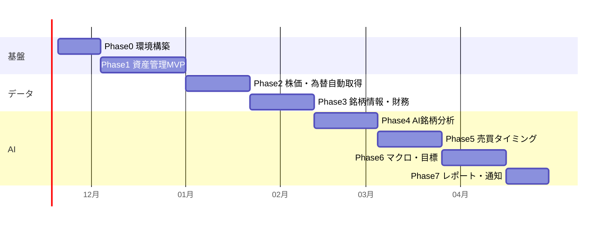

# 6. 開発ロードマップ

**この章で決めること:** どの順番で作り、各段階で何ができるようになるか。

各段階は「動くものを作って使い始める → 次へ」の順に進めます。
1段階ごとに **説明 → 少しずつ実装 → 動作確認 → 次の作業** を繰り返します。
期間は週5〜10時間程度の作業を想定した目安です。

---

## Phase 0:開発環境とひな形(約2週間)
**ゴール:** ログインしてダッシュボード(空)が iPhone と PC で見られる

| 作業 | 内容 | 学べること |
|---|---|---|
| 0-1 | アカウント作成: GitHub / Vercel / Supabase(手順書を用意) | 各サービスの役割 |
| 0-2 | 新規リポジトリ作成、Next.js + TypeScript + Tailwind のひな形 | プロジェクトの構造 |
| 0-3 | Supabase 接続、ログイン(新規登録無効・2段階認証) | 認証の仕組み |
| 0-4 | 共通レイアウト(タブバー/サイドバー)、ダークモード | 画面部品の作り方 |
| 0-5 | Vercel に自動デプロイ、環境変数の設定 | 公開の仕組み・秘密情報の扱い |
| 0-6 | テスト環境(Vitest)と自動チェック(GitHub Actions) | テストの意味 |

## Phase 1:資産管理MVP(約4週間) ← **第1段階の実装範囲(承認後に開始)**
**ゴール:** 手入力で全資産を登録し、正確な総資産・損益・配分が見られる

| 作業 | 内容 |
|---|---|
| 1-1 | DBテーブル作成: profiles / accounts / instruments / transactions / cash_snapshots / manual_assets / manual_asset_valuations / goals(RLS付き) |
| 1-2 | 計算エンジン: 金額型・移動平均法・実現損益・円換算・為替要因分解・税金概算 **+ テスト** |
| 1-3 | 口座・銘柄・取引の入力画面 |
| 1-4 | 手動資産(不動産等)の入力画面 |
| 1-5 | 資産一覧・保有銘柄詳細・ホームの総資産と配分グラフ |
| 1-6 | 現在値は**手入力**(Phase 2で自動化)。出典「手入力」と日時を表示 |
| 1-7 | 目標設定と進捗表示 |

**完了の確認方法:** 実際の証券会社の取引報告書と、取得単価・実現損益が1円単位で一致すること

## Phase 2:株価・為替の自動取得と資産推移(約3週間)
- J-Quants / FMP / Frankfurter の取得処理、定期ジョブ、`job_runs`
- 日次スナップショット、資産推移グラフ(日/月/年)
- 証券会社CSV取り込み、NISA枠管理
- データの鮮度表示・取得失敗表示

## Phase 3:銘柄情報・財務(約3週間)
- 財務データ・決算予定の取得、指標の自前計算(PER/PBR/ROE/成長率)
- 銘柄詳細画面(チャート・財務・ニュース)、ウォッチリスト、配当管理

## Phase 4:AI銘柄分析(約3週間)
- 投資方針の入力画面
- 分析パイプライン(09章)、構造化出力、出力検証
- AI分析タブ・AI分析一覧・分析履歴、API費用の記録と上限

## Phase 5:売買タイミング・シナリオ(約3週間)
- 価格候補・シナリオの計算、根拠の展開表示
- 新規購入候補・売却候補の提案、同業比較

## Phase 6:マクロ経済・目標シミュレーション(約3週間)
- FRED / e-Stat / 日銀データ取得、マクロ画面、AIマクロ解説
- 将来資産シミュレーション、不動産の詳細管理

## Phase 7:投資レポートと通知(約2週間)
- 日次/週次/月次レポートの自動生成
- メール or プッシュ通知、価格アラート、AIへの質問(チャット)

## Phase 8 以降:拡張(08章)

---

## 各段階の進め方(毎回同じ流れ)

1. **説明:** その段階で作るもの・仕組みを図と言葉で説明
2. **小さく実装:** 1回の変更は1つの機能単位(画面1つ、計算1つ)
3. **動作確認:** 手順を示し、実際に触って確認していただく
4. **コミット:** 変更内容を記録(Git)
5. **振り返り:** 疑問点の解消、次の作業の確認
