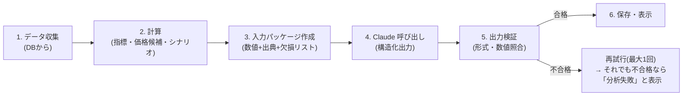

# 9. AI分析エンジン設計

**この章で決めること:** AIにどんなデータを渡し、どんな形で答えさせ、どう検証するか。
「根拠のない価格を出さない」「推測で埋めない」をどう仕組みで保証するか。

---

## 9.1 分析パイプライン



### 1. データ収集
- 銘柄情報、直近の株価(1〜5年の日足)、財務(過去5年 + 予想)、決算予定、ニュース(直近30日)
- マクロ指標(金利・為替・CPI等の最新値と変化)
- 自分の保有状況(数量・取得単価・含み損益・ポートフォリオ内の比率・同業種比率)
- 投資方針(期間・リスク許容度・1銘柄上限など)

### 2. 計算(プログラム)
| 計算項目 | 例 |
|---|---|
| バリュエーション | PER(実績/予想)、PBR、配当利回り、過去5年のPER分布(25%・中央値・75%点) |
| 成長性 | 売上・営業利益・EPSの前年比、3年平均成長率 |
| 財務健全性 | 自己資本比率、D/Eレシオ、営業CFのプラス継続年数 |
| テクニカル | 25/75/200日移動平均、RSI(14)、MACD、ATR(14)、52週高値安値、直近の高値安値 |
| ポートフォリオリスク | この銘柄の比率、業種集中度、通貨集中度、方針上限との差 |
| **価格候補** | 下表 |
| **シナリオ株価** | 下表 |

#### 価格候補の算出方法(プログラムが計算 → AIは選択と説明のみ)
| 種類 | 算出方法の候補 | 計算式の例 |
|---|---|---|
| 目標株価 | PERバンド法 | 予想EPS × 過去5年PER中央値 |
| | PBRバンド法(金融・資産株) | BPS × 過去5年PBR中央値 |
| | 配当利回り法(高配当株) | 予想配当 ÷ 過去5年の平均配当利回り |
| 新規購入検討 | 割安水準 | 予想EPS × 過去5年PER 25%点 |
| | 支持線 | 200日移動平均、直近安値 |
| 買い増し検討 | 支持線 / 取得単価との関係 | 75日移動平均、平均取得単価 −X%(方針で設定) |
| 利益確定検討 | 割高水準 | 予想EPS × 過去5年PER 75%点、目標株価到達 |
| 損切り検討 | ボラティリティ基準 | 直近安値 − 2×ATR |
| | 方針基準 | 取得単価 −(許容損失率)%(投資方針から) |

**データ不足で計算できない候補は作らない**(例:赤字企業はPERバンド法を使えない → 他の方法 or 「算出不可」)。

#### シナリオ株価
```
シナリオ株価 = 想定EPS(12か月後)× 想定PER
弱気: EPS = 予想EPS × (1 − 過去の下振れ幅), PER = 過去5年PER 25%点
基本: EPS = 予想EPS,                   PER = 過去5年PER 中央値
強気: EPS = 予想EPS × (1 + 過去の上振れ幅), PER = 過去5年PER 75%点
```
前提値はすべて画面に表示し、後から変更して再計算できるようにします。

### 3. 入力パッケージ
すべての数値に ID を振り、出典・基準日を付けて Claude に渡します。
```json
{
  "facts": [
    {"id": "F12", "label": "予想EPS(会社予想 FY2026)", "value": 230.5, "unit": "JPY",
     "source": "J-Quants", "as_of": "2026-11-05"},
    {"id": "F13", "label": "過去5年PER中央値", "value": 15.1, "source": "computed", "as_of": "2026-11-12"}
  ],
  "price_candidates": [
    {"id": "P3", "kind": "target", "method": "per_band", "price": 3480, "basis_fact_ids": ["F12","F13"]}
  ],
  "missing": ["アナリスト予想", "決算発表予定日"]
}
```

### 4. Claude 呼び出し
- **構造化出力**(JSON Schemaで回答の形を強制)を使用
- システムプロンプトに固定ルールを記載(下記 9.3)。プロンプトキャッシュで費用削減
- ニュース・業界動向は Web検索ツールで取得し、引用URLを保存

### 5. 出力検証(プログラム)
| チェック | 内容 |
|---|---|
| 形式 | Zod で JSON Schema どおりか(判断は6種類のどれか、スコアは0〜100 等) |
| 価格の根拠 | AIが出した各価格が `price_candidates` のIDを参照し、価格が一致しているか。**一致しない価格は破棄** |
| 事実の参照 | 理由に含まれる数値が `facts` のIDを参照しているか。存在しないIDは不合格 |
| 欠損の扱い | `missing` の項目をAIが値ありとして使っていないか |
| 整合性 | 判断「強い買い」なのに総合スコアが低い等の矛盾がないか(閾値ルール) |
| 方針整合 | 1銘柄上限を超える買い増し提案になっていないか(超える場合は警告を付ける) |

---

## 9.2 出力の形(JSON Schema の概要)

```ts
type StockAnalysis = {
  rating: "strong_buy" | "buy" | "hold" | "trim" | "sell" | "watch";
  overall_score: number;          // 0-100
  confidence: "low" | "medium" | "high";
  confidence_reason: string;      // 確信度の理由(データ不足ならlowにする)
  scores: {
    growth: Score; financial_health: Score; moat: Score; industry_outlook: Score;
    valuation: Score; technical: Score; market_environment: Score;
    macro_rates_fx: Score; portfolio_fit: Score;
  };
  reasons: { text: string; fact_ids: string[] }[];
  risks: { text: string; severity: "low" | "medium" | "high"; fact_ids: string[] }[];
  price_levels: { kind: string; candidate_id: string; comment: string }[]; // 候補IDから選ぶだけ
  scenario_comment: string;
  what_would_change_my_mind: string[];  // 判断が変わる条件
  unused_due_to_missing: string[];
};
type Score = { score: number | null; comment: string; fact_ids: string[] }; // データ不足は null
```

### 6段階判断の目安(プロンプトで定義)
| 判断 | 意味 |
|---|---|
| 強い買い | 割安かつファンダメンタルズ良好、確信度が高い。方針の上限内で積極的に検討 |
| 買い | 魅力はあるが、割安度・確信度は「強い買い」ほどではない |
| 保有 | 現状維持が妥当。買い増し・売却の積極的理由なし |
| 一部利益確定 | 割高水準到達、または比率が方針上限超過。一部売却で調整を検討 |
| 売却 | 投資理由の崩れ、財務悪化など。保有継続の理由が乏しい |
| 様子見 | データ不足・決算直前・不確実性が高く、判断を保留すべき |

---

## 9.3 システムプロンプトの基本ルール(抜粋)

1. あなたはユーザー個人の投資分析を補助するアナリストです。最終判断はユーザーが行います
2. 数値は `facts` に含まれるものだけを使い、必ず `fact_ids` で参照すること。計算はしないこと
3. `missing` にあるデータは「不明」として扱い、推測で補わないこと。不足が判断に影響する場合は確信度を下げるか「様子見」とすること
4. 価格は `price_candidates` から選ぶこと。新しい価格を作らないこと
5. 楽観的・悲観的のどちらにも偏らず、反対意見(判断が変わる条件)を必ず書くこと
6. 日本語で、専門用語には短い説明を添えること
7. ニュースを使う場合は出典URLを引用すること

---

## 9.4 AIの成績検証(D-4)

- 過去の判断と、その後 1/3/6/12か月の株価(配当込み)を比較
- 判断別の平均リターン、TOPIX/S&P500 との比較を表示
- 「AIの判断がどれくらい当てになるか」を自分で評価できるようにする
- プロンプトを改良した場合は `prompt_version` ごとに比較
